<p align="center">
  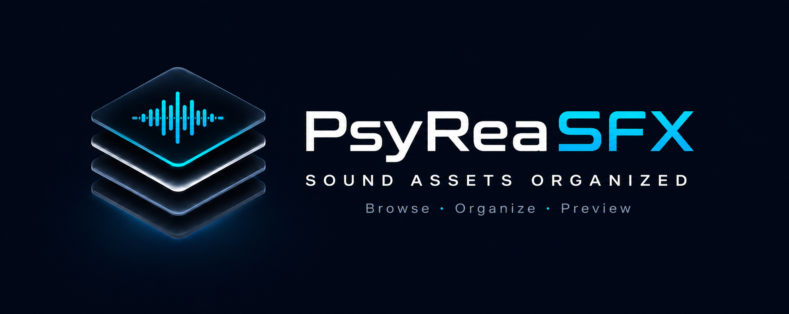
</p>

<h1 align="center">Psysia REAPER 工具集</h1>

<p align="center">
  面向声音设计、轨道整理、渲染、工程管理与音效资产工作流的实用 REAPER 工具集。
</p>

<p align="center">
  <strong>简体中文</strong> · <a href="README.md">English</a>
</p>

<p align="center">
  
  
  
</p>

<p align="center">
  <a href="https://psysia.github.io/PsyReaSFX/">
    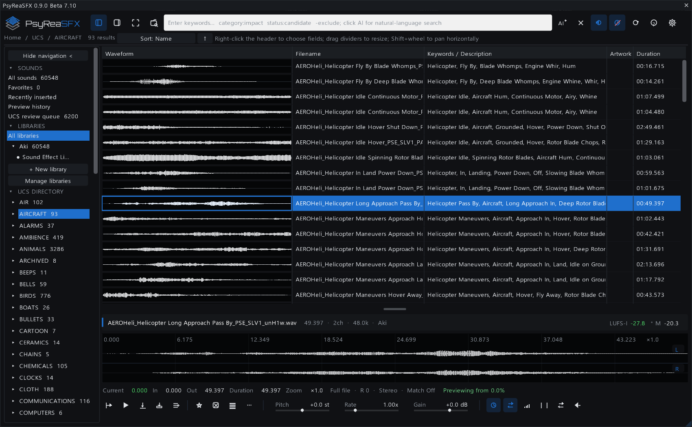
  </a>
</p>
<p align="center"><em>PsyReaSFX 0.9 Beta 7.10 实际运行界面 · UCS 分类导航、音效列表、内联波形及详细试听面板。</em></p>
<p align="center"><a href="https://psysia.github.io/PsyReaSFX/">Website / 官网</a> · <a href="https://psysia.github.io/PsyReaSFX/#scripts">Live GIF demos / 动态演示</a> · <a href="https://github.com/Psysia/PsyReaSFX/releases">Releases</a></p>

## 项目简介

这个仓库包含两部分：

- **PsyReaSFX**：运行在 REAPER 内部的完整音效资产工作区。
- **REAPER 实用工具**：面向剪辑、文件夹管理、渲染、显示与工程操作的轻量 ReaScript。

所有轻量工具都可以独立安装，不需要先安装 PsyReaSFX。

## 安装

在 REAPER 中打开 `扩展 → ReaPack → 导入仓库...`，添加：

```text
https://raw.githubusercontent.com/Psysia/PsyReaSFX/main/index.xml
```

随后执行 `扩展 → ReaPack → 同步软件包`，直接搜索需要的工具并安装即可。使用 Beta 8.3 时，先为软件包启用
预发布版本并安装 `PsyReaSFX.lua`；如需 Windows x64 神经相似声音检索，再为同仓库
中的独立可选包 [PsyReaSFX Neural Similarity][neural-download] 启用预发布并安装。

### 神经相似声音检索：附加包下载与安装

**“相似声音”有两种自动切换的引擎：基础 15 维声学检索内置于主程序；
EfficientAT 神经检索必须安装独立附加包，更新主脚本不会自动安装它。**
AI 语义搜索是另一个功能，不依赖此包。

**[直接下载完整神经包 ZIP · Beta 8.3 · Windows x64 · 约 42.4 MB][neural-download]**
（包含程序、模型与安装脚本；不要只下载 Release 中的裸 EXE，它不含模型。）

- **推荐 ReaPack：** 使用上方仓库地址，同步后打开
  `扩展 → ReaPack → 浏览软件包 / Browse packages`，搜索
  [PsyReaSFX Neural Similarity][neural-download]，选中独立数据包（不是主程序）。
  右键勾选 **Enable pre-releases (bleeding-edge)**，在 **Versions** 选
  `0.9.0-beta8.3`，取消 **Pin current version**，点击 **Apply / OK**，
  下载结束后关闭旧窗口并重新运行 PsyReaSFX。
- **手动安装：** 下载上面的完整 ZIP，全部解压后双击
  `Install-NeuralSimilarity.cmd`，完成后重启 PsyReaSFX。便携版 REAPER 的资源目录
  指定方式见[安装说明](neural/package/README_zh-CN.md#手动-zip-备用方式)。

只需选择一种安装方式。ReaPack 安装位置为
`<REAPER 资源目录>\Data\PsyReaSFX\neural_similarity\`；
手动安装默认位于 `%APPDATA%\REAPER\Scripts\PsyReaSFX\neural_similarity\`。
无需另装 Python 或 .NET，不上传音频，也不生成转码音频副本。
首次使用会建立可取消的特征缓存与索引；组件缺失或异常时自动回退基础声学检索。

### 想使用最新版功能？安装 0.9 Beta

普通同步默认跟随稳定版，**不会自动加入 Beta**。最新 UCS 分类、相似声音、AI 语义搜索和启动动画位于 0.9 Beta：

1. 执行 `扩展 → ReaPack → 同步软件包`，再打开 `浏览软件包 / Browse packages`，搜索 `PsyReaSFX`。
2. 右键主程序 `PsyReaSFX`（脚本包 `PsyReaSFX.lua`），勾选 **Enable pre-releases (bleeding-edge)**。
3. 再次右键 → **Versions**，选择最新 `0.9.0-beta…`（当前 `0.9.0-beta8.3`）。不要勾选 **Pin current version**；已固定时先取消固定。
4. 点击 **Apply**，或 **OK** 确认应用安装；下载完成后关闭旧 PsyReaSFX 窗口，从 REAPER 动作列表重新运行。

<p><a href="website/assets/screenshots/reapack-enable-beta.jpg">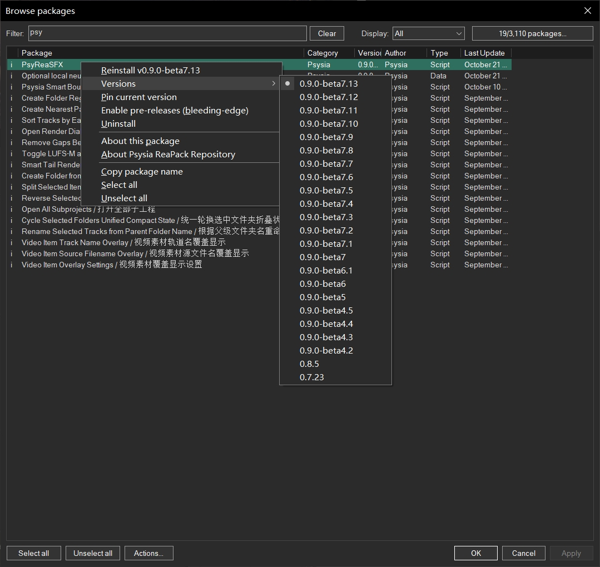</a></p>

截图用于演示右键菜单位置，拍摄时仍显示历史 Beta；同步后 Versions 仅保留最新 Beta、0.8.5 Stable 和 0.7.23 Stable。旧版仍可从 GitHub Releases 下载。

**神经检索需另装包，AI 搜索需自行配置 API：** Windows x64 如需本地神经检索，对独立包 [PsyReaSFX Neural Similarity][neural-download] 重复启用预发布与安装步骤，再重启主程序。AI 语义搜索无需[神经包][neural-download]，但需在设置中填写自己的 DeepSeek / OpenAI / 兼容 API Key 和模型；普通回车仍是普通搜索，点击金色 AI 按钮才执行 AI 搜索。更新主程序不需要重建音效库。

## REAPER 实用工具

| 分类 | 工具 | 用途 |
|---|---|---|
| 渲染 | 创建文件夹区域与渲染矩阵 | 单一源轨道直接使用自身命名并勾选自身；多轨时才使用最近公共父级。 |
| 渲染 | 智能合并渲染（轨道 FX / 父文件夹 FX） | 选中 Item 优先，跨轨合并单个 WAV，尾音最多 5 秒；不修改 Solo，渲染后自动刷新波形。 |
| 渲染 | 按最近父文件夹创建区域与渲染矩阵 | 单条普通子轨使用最近一级父 Folder 命名并勾选 Matrix；Folder 轨自身使用自己。 |
| 渲染 | 智能尾音渲染面板 | 配置渲染尾音、静音裁切阈值与安全留白。 |
| 渲染 | 打开渲染窗口并应用自动尾音 | 在打开原生渲染窗口前应用已保存的尾音设置。 |
| 轨道管理 | 按最早素材位置排序轨道 | 文件夹感知排序，完整保留 Folder 子树结构。 |
| 轨道管理 | 从选中轨道创建文件夹并挂载 Pro-L 2 | 将同级轨道或完整 Folder 子树包进新的总线，并挂载 Pro-L 2。 |
| 轨道管理 | 统一轮换选中文件夹折叠状态 | 根据是否存在嵌套，自动使用两状态或四状态折叠逻辑。 |
| 轨道管理 | 根据父级文件夹名重命名选中轨道 | 使用最近一级父文件夹名称给子轨编号命名。 |
| 素材编辑 | 移除选中素材间隙 | 按现有顺序将选中素材首尾相接。 |
| 素材编辑 | 拆分选中素材到新轨道 | 保持时间位置，将选中素材移动到独立新轨道。 |
| 素材编辑 | 原位反转选中素材 | 通过可一次撤销的 Take 流程反转选中素材。 |
| 工程管理 | 打开全部子工程 | 递归打开当前工程引用的全部子工程。 |
| 显示 | 切换 LUFS-M 与频谱图 | 在 LUFS-M 频谱峰值显示与频谱图之间切换。 |
| 显示 | 视频素材轨道名覆盖显示 | 在视频 Item 内显示当前轨道名称，需要时可直接切换到文件名模式。 |
| 显示 | 视频素材源文件名覆盖显示 | 在视频 Item 内显示源视频文件名并隐藏扩展名，可随时直接切回轨道名模式。 |

详细使用方式、边界条件、依赖关系与快捷键建议见 [REAPER 工具手册](docs/REAPER_TOOLS_GUIDE_zh-CN.md)。

## REAPER Lua 工具动态演示

**全部来自 REAPER 实际操作录屏，而非概念效果图。** 下方展示脚本的直接操作效果；各工具可通过同一 ReaPack 仓库独立安装。

[**前往官网观看全部 GIF 动态演示 ↗**](https://psysia.github.io/PsyReaSFX/#scripts) · [所有 Lua 工具](Scripts/Psysia/) · [完整使用手册](docs/REAPER_TOOLS_GUIDE_zh-CN.md)

<table>
  <tr>
    <td width="50%" align="center"><strong>智能合并渲染</strong><br>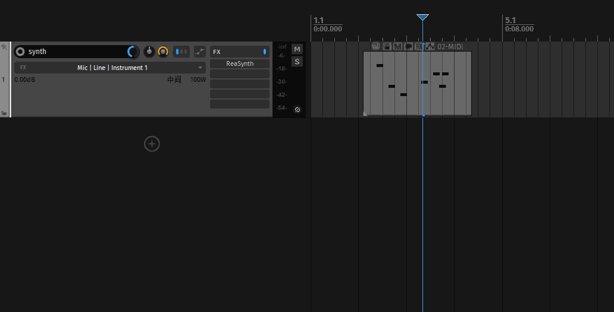</td>
    <td width="50%" align="center"><strong>视频素材轨道名覆盖显示</strong><br>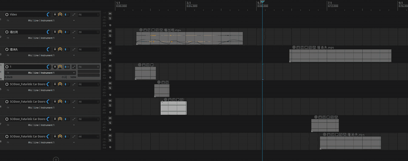</td>
  </tr>
  <tr>
    <td width="50%" align="center"><strong>创建文件夹区域与渲染矩阵</strong><br>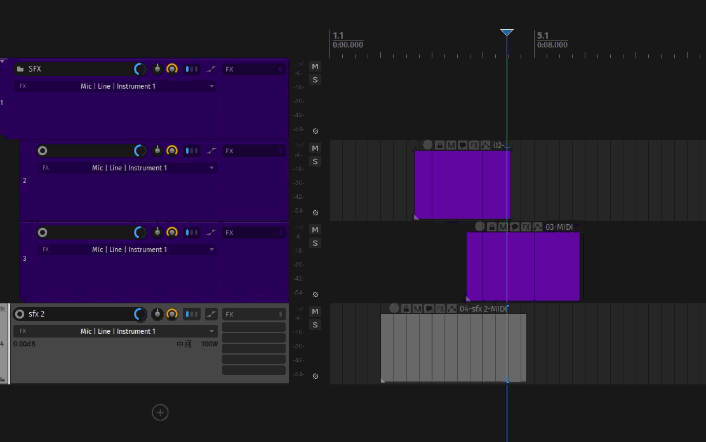</td>
    <td width="50%" align="center"><strong>统一轮换文件夹折叠状态</strong><br>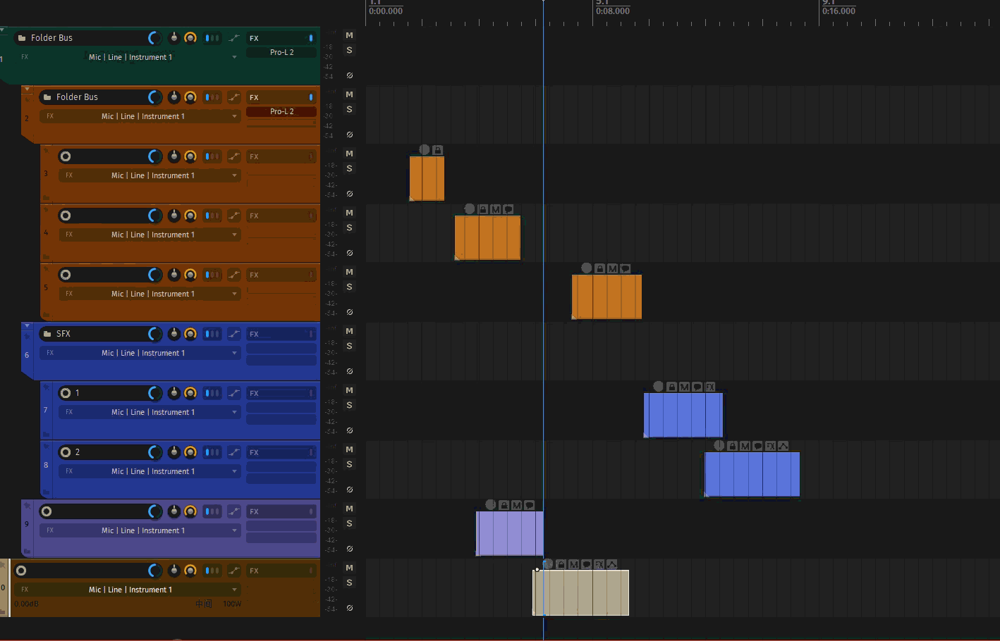</td>
  </tr>
</table>

<details>
<summary><strong>展开另外 8 个 Lua 工具的 GIF 演示</strong></summary>

<table>
  <tr>
    <td width="50%" align="center"><strong>按最早素材位置排序轨道</strong><br>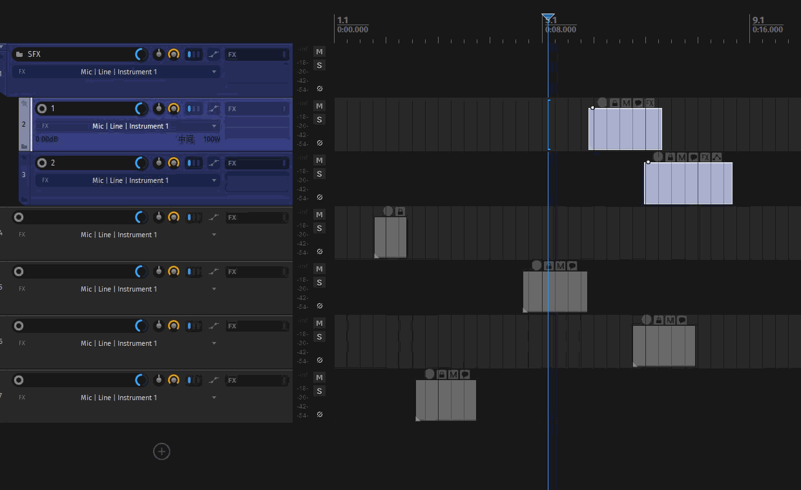</td>
    <td width="50%" align="center"><strong>按最近父文件夹创建区域与渲染矩阵</strong><br>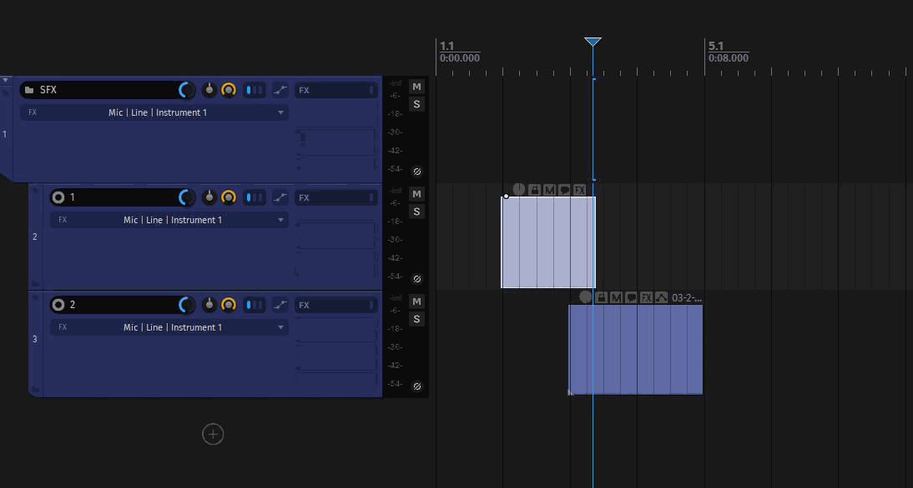</td>
  </tr>
  <tr>
    <td width="50%" align="center"><strong>根据父级文件夹名重命名选中轨道</strong><br>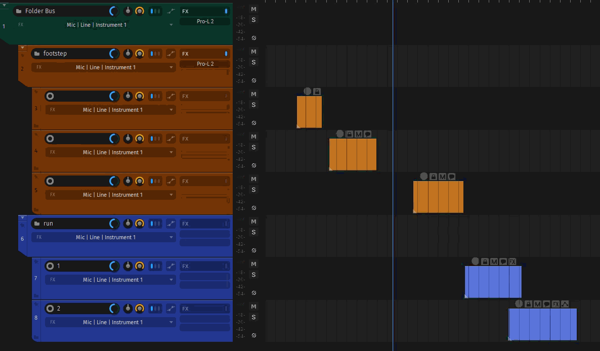</td>
    <td width="50%" align="center"><strong>拆分选中素材到新轨道</strong><br>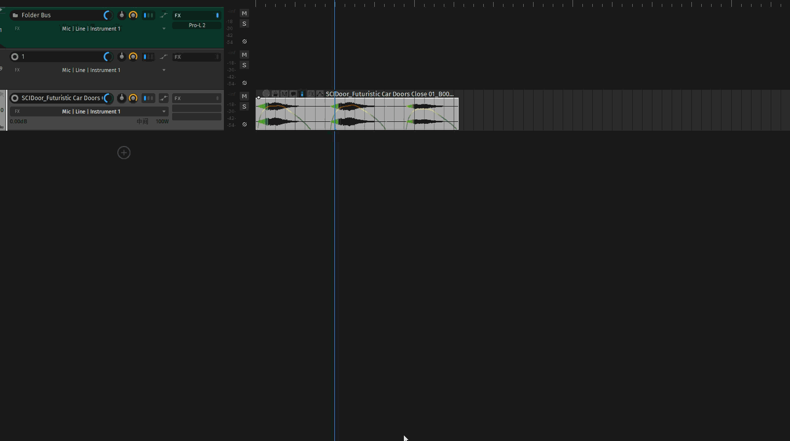</td>
  </tr>
  <tr>
    <td width="50%" align="center"><strong>移除选中素材间隙</strong><br>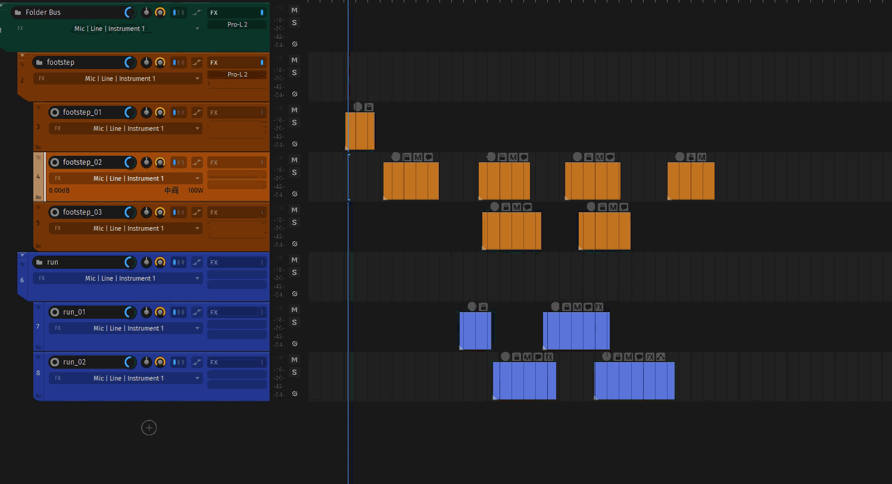</td>
    <td width="50%" align="center"><strong>原位反转选中素材</strong><br>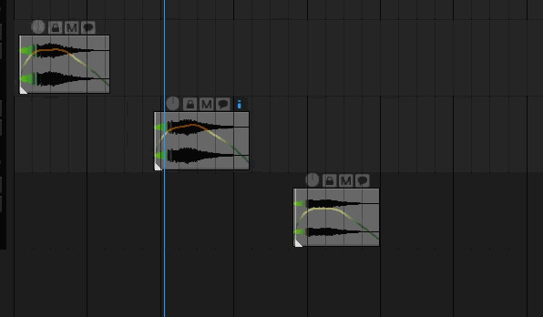</td>
  </tr>
  <tr>
    <td width="50%" align="center"><strong>切换 LUFS-M 与频谱图</strong><br>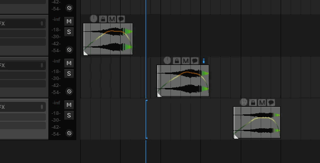</td>
    <td width="50%" align="center"><strong>从选中轨道创建文件夹并挂载 Pro-L 2</strong><br>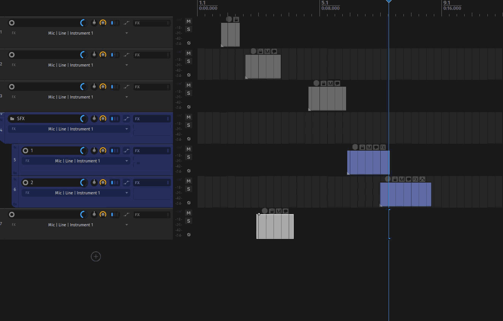</td>
  </tr>
</table>

</details>

## PsyReaSFX

**PsyReaSFX** 是一个可停靠在 REAPER 内部的音效资产工作区，集中提供素材库管理、波形浏览、试听、元数据、集合、搜索、REAPER 插入与处理后交付。

| 通道 | 版本 | 说明 |
|---|---|---|
| 稳定版 | **0.8.5** | 推荐日常使用。 |
| 预发布版 | **0.9.0 Beta 8.3** | 复用标签编号、修复切换回跳、加速结果刷新。 |
| 可选组件 | [PsyReaSFX Neural Similarity][neural-download] | Windows x64 本地神经相似声音检索组件。 |

未安装[神经组件][neural-download]时，PsyReaSFX 仍可使用原有声学相似检索。AI 语义搜索是独立的 API 功能，不会上传用户音频。

### 版本功能对比

以下仅比较 REAPER / Lua 版，Beta 包含稳定版功能；“—”表示该版本没有此功能。

| 功能 | 0.7.23 Stable | 0.8.5 Stable | 最新 0.9 Beta（8.3） |
|---|---|---|---|
| 浏览、波形试听、元数据、集合与 Transfer | 有 | 保留 | 保留 |
| 中断恢复、失败重试、自动备份与缓存检查 | — | 新增 | 保留并改进 |
| 缺失/重复素材检查、来源重定位、工程使用记录 | — | 新增 | 保留 |
| 大型库增量保存与分帧任务 | 早期实现 | 强化 | 进一步优化启动 |
| 官方 UCS 自动分类、待确认队列与虚拟目录 | 仅基础 UCS 字段 | 仅基础 UCS 字段 | 新增 |
| 频谱峰值着色 | — | — | 新增；按需启用 |
| 基于音频内容的相似声音检索 | — | — | 主程序内置 15 维声学检索 |
| EfficientAT 本地神经相似声音 | — | — | [神经检索必装包 · Windows x64 ZIP][neural-download] |
| AI 语义搜索：描述转检索词、本地召回和分页 | — | — | 自备 API Key / 模型；无需[神经包][neural-download] |
| 品牌启动动画与实时加载状态 | — | — | 新增；不延长加载 |
| 10–24 px 字号联动缩放与波形列适配 | — | — | 新增；设置 → 字体与导航 |
| 独立搜索 / 浏览标签页 | — | — | 新增；搜索下方 +，Ctrl+N / Ctrl+Tab |
| 左侧文件夹层级/根目录与模块开关 | — | — | 新增；音效库、文件夹或同时显示 |

逐版本新增与修复见[更新日志](docs/CHANGELOG_zh-CN.md)，
安装步骤见[官网 Beta 图解](https://psysia.github.io/PsyReaSFX/#beta-install)。

### 当前开发状态

ReaPack 的 Versions 菜单仅保留最新 Beta、0.8.5 Stable 和 0.7.23 Stable；[可选神经组件][neural-download]仅保留最新 Beta。历史预发布仍可从 GitHub Releases 下载，不会删除已有安装或素材数据。

- **稳定通道：0.8.5** — 面向日常使用的默认 ReaPack 版本。
- **预发布通道：0.9.0 Beta 8.3** — 复用空闲标签编号，修复切换回跳，加速结果刷新并明确更新提示；保留独立标签页、字号缩放、目录导航和 AI 预设。
- **不会建立转码素材库** — 源音频只在内存中解码、下混并重采样为模型所需的 32 kHz，不会生成转换后的音频副本；持久缓存只保存紧凑的 320 维 FP16 embedding 和 HNSW 索引。

0.9 预发布始终保留当前 15 维声学特征检索作为无需额外组件的基础模式。[神经相似度组件][neural-download]仅在本地运行，不上传用户音频；它对主程序可选，但对神经检索必需。

Beta 8.3 包含独立的 **AI 语义搜索**。它与“查找相似声音”完全分离：顶部搜索框按 `Enter` 执行普通搜索，点击金色 AI 按钮执行语义搜索。AI 只把自然语言描述转换为中英文检索词；素材召回、排序和每批 120 条的分页追加均在本地完成。API 不再接收候选元数据，因此继续加载下一批无需等待网络，也不会再次产生 API 请求。音频、素材文件名、元数据、目录和文件路径均不会上传。

> **ReaPack 安装方式：** 安装 `PsyReaSFX.lua` 即可使用主程序；Windows x64 用户如需神经检索，再从同一仓库安装第二个包 [PsyReaSFX Neural Similarity][neural-download]。两个包都由 ReaPack 独立更新，手动 ZIP 仅作为备用方案。

### 主要能力

**浏览标签页入口：** 搜索框下方标签栏分别保留搜索词、库/目录/集合筛选、排序、选择和滚动。点 **+** 或 `Ctrl+N` 新建；右键复制、重命名、关闭其他/右侧、左右移动。`Ctrl+Shift+N` 复制，`Ctrl+W` 关闭，`Ctrl+Tab` 切换。已完成 AI/相似结果及 AI 下一批进度保留在内存，进行中的请求需先完成或取消。重启恢复名称、顺序和普通条件，不自动调用 API 或分析音频。只更新主脚本并重开窗口即可，无需更新神经包或重建索引。[设计与性能说明](docs/UI_WORKSPACE_ARCHITECTURE_0_9_zh-CN.md)。

- 一个逻辑音效库可聚合多个实体来源文件夹。
- 列表内联波形，以及单声道、立体声和多声道详细预览。
- 联合搜索文件名、路径、元数据、UCS 字段、音效库和工作流状态。
- 独立 AI 语义搜索入口：支持 DeepSeek、OpenAI 与 OpenAI-compatible API，由 AI 扩展查询词并在本地完成素材召回与排序。
- 使用包络、起音、动态与频谱特征进行可解释的音频内容相似检索。
- 收藏、播放列表、项目素材箱、工作流状态与非破坏性元数据。
- Region、瞬态建议、LUFS / True Peak、Pitch / Rate / Gain 与声道监听。
- 插入当前轨、新轨、BWF 位置，以及把波形选区直接拖入 REAPER。
- Transfer 支持命名模板、格式转换、采样率与声道设置、淡化、标准化和重名策略。

### PsyReaSFX 下载

- [PsyReaSFX 最新稳定版](https://github.com/Psysia/PsyReaSFX/releases/latest)
- [PsyReaSFX 0.9.0 Beta 8.3 预发布](https://github.com/Psysia/PsyReaSFX/releases/tag/v0.9.0-beta8.3)
- [Beta 8.3 完整神经组件 ZIP 精确下载][neural-download]
- [PsyReaSFX 0.7.23 Stable 历史版本](https://github.com/Psysia/PsyReaSFX/releases/tag/v0.7.23)
- [全部 Releases](https://github.com/Psysia/PsyReaSFX/releases)
- [Desktop 项目说明](desktop/README.md)

[版本发布](https://github.com/Psysia/PsyReaSFX/releases) · [用户手册](docs/USER_GUIDE_zh-CN.md) · [更新日志](docs/CHANGELOG_zh-CN.md)

## 文档

| 文档 | 内容 |
|---|---|
| [REAPER 工具手册](docs/REAPER_TOOLS_GUIDE_zh-CN.md) | 轻量脚本的安装、功能与使用方式。 |
| [PsyReaSFX 用户手册](docs/USER_GUIDE_zh-CN.md) | 主程序工作流与功能说明。 |
| [PsyReaSFX 更新日志](docs/CHANGELOG_zh-CN.md) | 版本历史与更新内容。 |
| [0.9 → 1.0 开发路线](docs/ROADMAP_0_9_TO_1_0_zh-CN.md) | 版本演进与开发计划。 |
| [相似声音架构](docs/SIMILARITY_ARCHITECTURE_0_9_zh-CN.md) | 0.9 相似声音系统设计。 |
| [神经音频相似度架构](docs/NEURAL_SIMILARITY_ARCHITECTURE_0_9_zh-CN.md) | 本地神经检索架构。 |
| [AI 语义搜索架构](docs/AI_SEMANTIC_SEARCH_ARCHITECTURE_0_9_zh-CN.md) | API 语义搜索架构。 |

其余开发、性能与技术归档统一保存在 `docs/`，不再堆叠在项目首页。历史发布说明集中在 [docs/releases](docs/releases/README.md)，查看版本变化请使用更新日志或 GitHub Releases。

## 仓库结构

```text
Scripts/Psysia/   REAPER 实用脚本
docs/             使用手册、更新日志与技术文档
assets/           图片、字体、截图与随附数据
neural/           可选神经相似度组件
desktop/          Desktop 开发文件
website/          项目网站
index.xml         ReaPack 仓库索引
```

## 许可

作者：**Psysia**

Copyright © 2026 Psysia. All rights reserved.

仓库许可详情见 [LICENSE](LICENSE)，第三方资源继续遵循各自许可。

[neural-download]: https://github.com/Psysia/PsyReaSFX/releases/download/v0.9.0-beta8.3/PsyReaSFX_Neural_Similarity_v0_9_0_beta8_3_win_x64.zip
